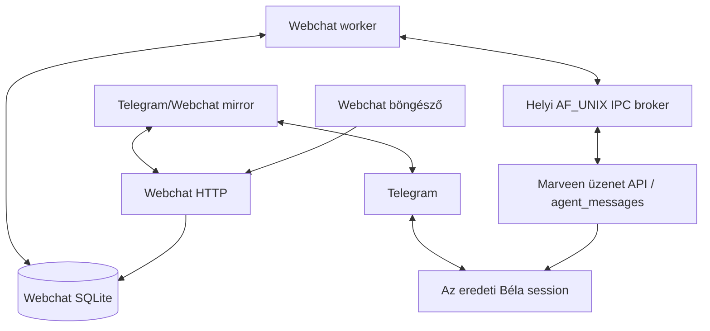

# Béla Webchat — P5.9.8

**Magyar nyelvű műszaki dokumentáció · Közös Béla-session · Webchat ↔ Telegram · Biztonságos hibakezelés**

A Béla Webchat a meglévő **Marveen/Béla** asszisztenshez biztosít helyi böngészős kezelőfelületet. A cél nem egy második, párhuzamos AI-ügynök indítása, hanem az **eredeti Béla-session** használata a Telegram és a Webchat felületéről, közös kontextussal. A rendszer kezeli a fájlcsatolásokat, a kétirányú üzenettükrözést és az aszinkron válaszokat.

> **Kiadás:** `P5.9.8` – egységes, tesztelt kiadásjelölt (RC). A 2026. november 20-i éles WSL-próbán a már működő P5.9.7.2 + UI-hotfix telepítést a telepítő **bájtpontosan átvette**, mentést készített, majd a `--verify` sikeres volt. Ekkor egyik szolgáltatás PID-je sem változott. A sikeres átadás **nem** jelent garantált 24/7 rendelkezésre állást.

## Mit tud?

| Funkció | Megvalósítás |
|---|---|
| Egyetlen eredeti Béla | A Webchat a Marveen `agent_messages` üzenetsorába adja át a kéréseket; nincs második Claude CLI worker |
| Webchat és Telegram | Közös üzenetfolyam, kétirányú tükrözés és visszajelzett kézbesítési állapot |
| Biztonságos átadás | Feladatonként ellenőrzött azonosító és tartós broker-fence; nem ismétel bizonytalan POST-ot |
| Elkülönített komponensek | HTTP frontend, worker, korlátozott Unix-socket broker és mirror külön systemd user service |
| Fájlcsatolások | Manifesttel, méret- és SHA-ellenőrzéssel átadott csatolmányok |
| Helyreállítás | Worker/broker újraindításakor a már `submitted` feladat eredményének figyelése folytatódhat |
| Telepítő | `--check`, `--apply`, `--verify`, `--enable`, `--pause`, `--rollback` |
| UI-hotfix | A befejezett feladat és a hét korábbi zárolt sor megfelelő állapotkijelzése |

## Architektúra röviden



Az ábra logikai kapcsolatokat mutat, nem titkos API-végpontokat vagy valós telepítési címet. A Marveen saját üzenetirányítója közvetetten ébresztheti az eredeti Béla-sessiont; ezért a közös session **nem jelent teljes erőforrás-függetlenséget** a két felület között.

## Gyorsindítás — már telepített P5.9.7.2 + UI-hotfix esetén

A kiadást először egy munkakönyvtárba csomagold ki. A jelenlegi kiadásból:

```bash
python3 -B test_p597.py
python3 -B test_p597_install.py
python3 -B test_unified_release.py
python3 -B test_fault_recovery.py
node --check app.js
node test_ui.mjs
python3 -B install_p598.py --check
```

**Csak sikeres előellenőrzés és mentés mellett**:

```bash
python3 -B install_p598.py --apply
python3 -B install_p598.py --verify
```

Ha a meglévő telepítés bájtpontosan egyezik, az átvétel **nem** módosítja a programfájlokat, **nem** indítja újra a Telegramot/Webchatet, és megtartja az `enabled` kapcsolót. Eltérő állapotnál a telepítő leáll. Tiszta P5.9.6.1-ről másik telepítési ág fut, alapértelmezésben szüneteltetett üzenetfeldolgozással.

**Visszaállítás** kizárólag nyitott vagy bizonytalan Marveen-átadás nélkül:

```bash
python3 -B install_p598.py --rollback
```

⚠️ A P5.9.8 után ne használd a régebbi P5.9.7.x telepítők vagy a külön UI-hotfix visszaállító kapcsolóit.

## Részletes útmutatók

- [Architektúra és üzenetútvonal](docs/ARCHITEKTURA.md)
- [Telepítés, átvétel és visszaállítás](docs/TELEPITES.md)
- [Üzemeltetés és hibakeresés](docs/UZEMELTETES.md)
- [Hibatesztek, bizonyítékok és korlátok](docs/TESZTELES.md)
- [Biztonság és titokkezelés](SECURITY.md)
- [Kiadási változásjegyzék](CHANGELOG_P598_HU.md)
- [Eredeti részletes kiadási leírás](README_P598_HU.md)
- [Eredeti offline tesztjelentés](TESZTJELENTES_P598_HU.md)
- [SHA-256 kiadási manifest](MANIFEST_SHA256.json)

## Mit NEM állítunk?

- Az izolált, sikeres `SIGKILL`-hibatesztek nem bizonyítják, hogy **minden** éles, hosszú feladat megszakításakor a Telegram sérthetetlen.
- A `posting` időablakban elveszett visszaigazolást a rendszer szándékosan `uncertain` állapotban őrzi; **nem küldi automatikusan újra**. Manuális egyeztetés kellhet.
- A frontend fejlécében még `P5.9.7 PILOT` szerepelhet: az éles `app.js` kód szándékosan bájtpontos megőrzése miatt nem változtattunk rajta.
- A `BROKER_RESTART_OK` aláhúzásai a Webchat Markdown-megjelenítésében eltűnhetnek; ez külön megjelenítési hiba, nem üzenetfeldolgozási hiba.
- A repo **nem tartalmazza** az eredeti Marveen teljes forráskódját, éles SQLite-adatbázisokat, `.env`-et, tokeneket, feltöltött felhasználói fájlokat vagy a helyi mentéseket.

## Környezet és kompatibilitás

- WSL2 / Ubuntu, `systemd --user`, Python 3, Node.js (a frontend teszteléséhez)
- Meglévő Marveen/Béla; a telepítő a forrást **`bfd79f75`** commitra és ellenőrzőösszegekre rögzíti
- A tényleges telepítésben privát fájlok és a Marveen helyi adatbázisa szükségesek; ez a tároló nem „egy parancsos” független alkalmazás

**Licenc:** nem adunk meg automatikusan nyílt forráskódú licencet; az elérhető forrás nem jelent engedélyt tetszőleges újrafelhasználásra. Ezt a tulajdonos később döntheti el.
